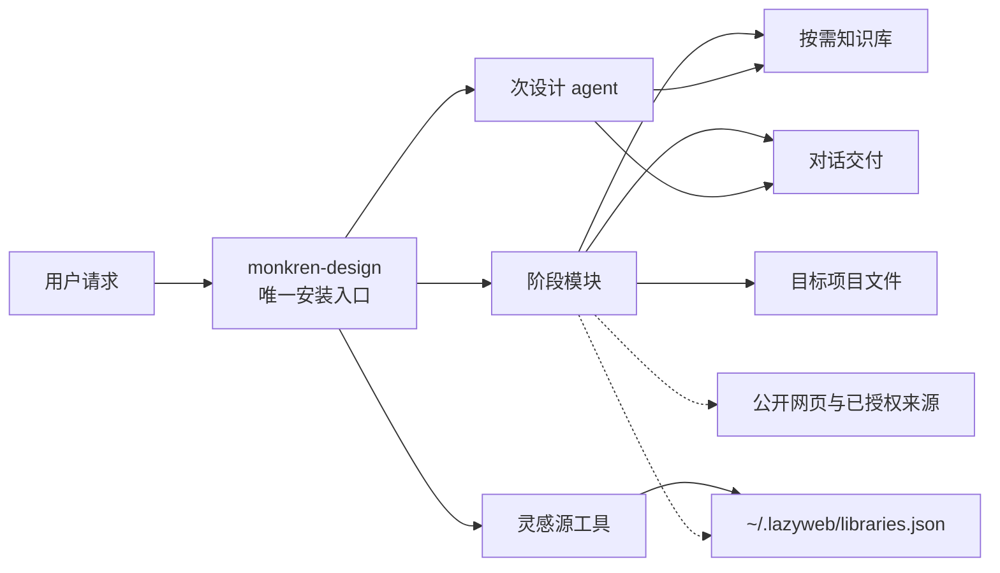
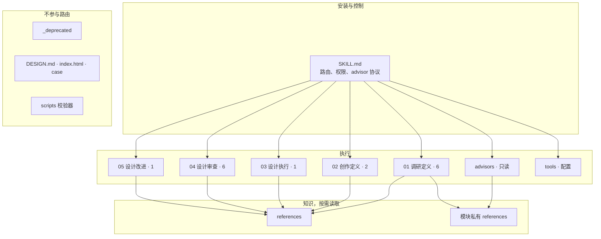
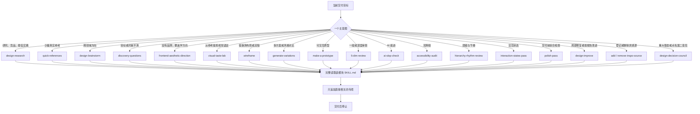
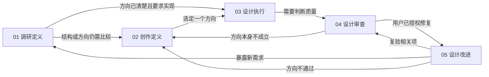
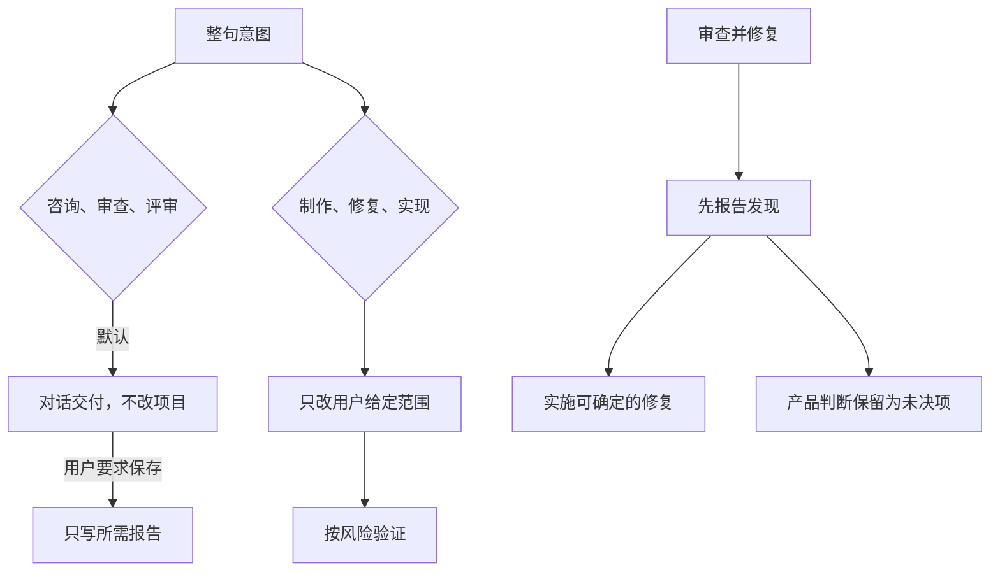
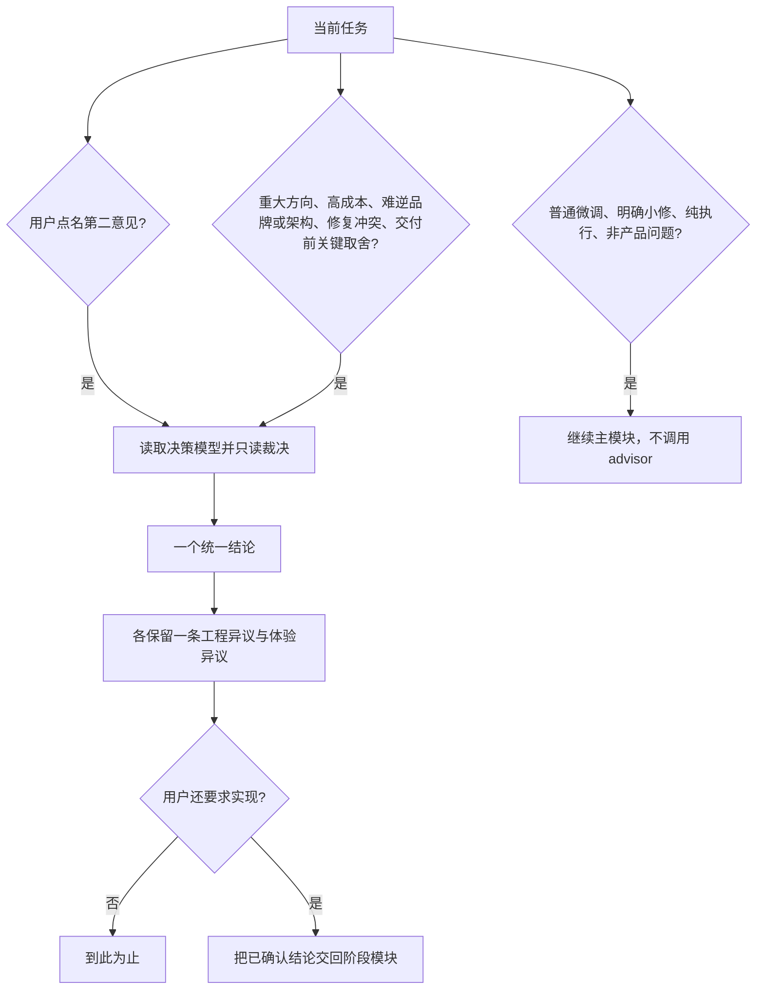
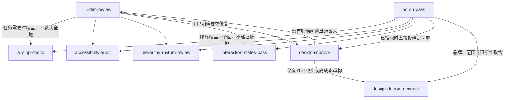
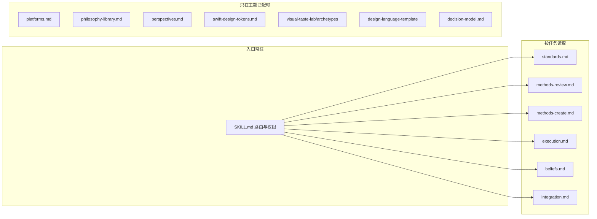
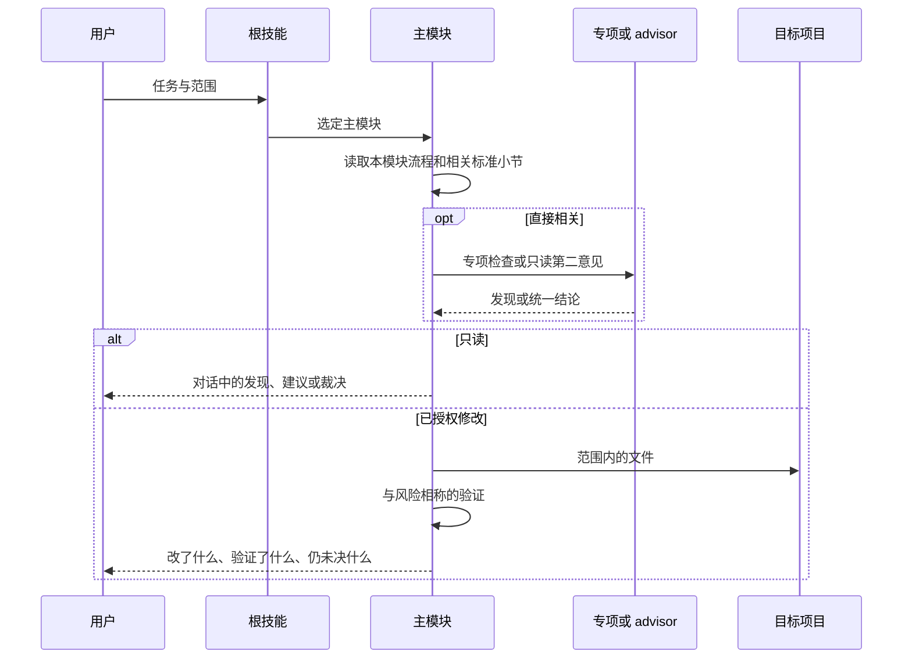
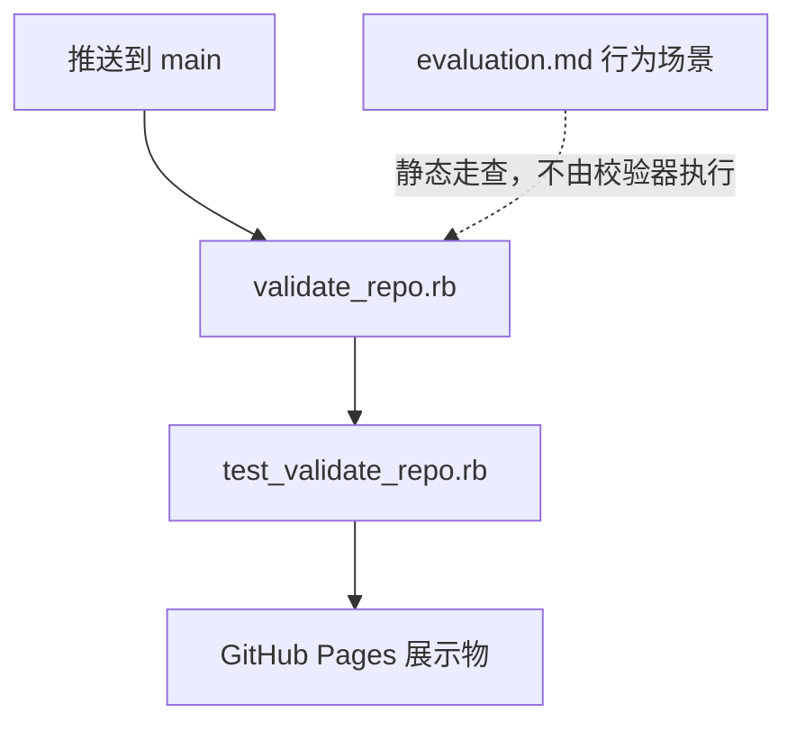

# Monkren Design 架构

> 版本 **v6.2** / 2026-07-17。本文描述可安装技能 `monkren-design` 的运行结构：谁是入口、请求如何选模块、权限停在哪里、知识何时加载、产出写到哪里。执行步骤以各模块的 `SKILL.md` 为准；评分数值以 [standards.md](standards.md) 为准。

标准安装只暴露根技能。16 个阶段模块、1 个 advisor 和 2 个工具随仓库一起分发，不是要求用户分别安装的产品。一次请求选择一个主模块，必要时再追加直接相关的专项；达到本次交付即停止，不自动跑完五个阶段。

## 1. 系统上下文

实线是控制流或写入。虚线是可选增强：外部来源和已登记灵感库可以缺席，调研、创作、审查和改进的核心路径仍然完成。浏览器、MCP 和子代理同样不是前置依赖。

## 2. 分层

| 层 | 位置 | 职责 |
|---|---|---|
| 入口 | [SKILL.md](../SKILL.md) | 识别阶段，选择一个主模块，声明读写边界 |
| 阶段 | `skills/01-research` 至 `skills/05-improve` | 定义该任务的流程、证据和交付 |
| 跨阶段 | `skills/advisors`、`skills/tools` | 第二意见，以及灵感源登记 |
| 知识 | `references/` 与模块内 `references/` | 标准、方法、平台和哲学；不一次全部加载 |
| 展示 | [DESIGN.md](../DESIGN.md)、`index.html`、`case/` | 本仓库展示页和案例版式，不是客户产品的默认品牌 |
| 治理 | `scripts/validate_repo.rb` | 元数据、路由、链接、图片索引和展示页资源 |

入口定义范围与权限，模块定义流程，共享标准维护判断依据。工具能力服从当前环境。

## 3. 路由

根技能先看整句意图，再选定主模块。审查、评审、audit、review 默认只读。修复、改进、打磨、实现、制作按用户已经给出的范围执行。“如何改进”和“给建议”仍是咨询，不因为句中出现“改进”就改文件。

明确的局部修复直接进入 [design-improve](../skills/05-improve/design-improve/SKILL.md)，不为一个按钮或一段间距强制完整审查。用户同时要求“审查并修复”时，先给出发现，再实施可确定的修复；需要产品判断的项目保留为未决项。

`_deprecated/` 中的 `component-extract`、`design-system-extract`、`make-tweakable`、`make-a-deck` 不进入路由表。校验器要求根技能的路由集合与活跃模块集合一致。

## 4. 生命周期与回流

五个阶段回答不同问题。它们可以按任务跳转，但不是每次都顺序执行。

活跃创作链的默认形态是：需求澄清，然后线框或变体，然后可交互原型，然后审查，授权后再改进。保真度跟着不确定性走。

| 还不确定什么 | 最便宜的有效产出 | 模块 |
|---|---|---|
| 信息架构、页面骨架、步骤数 | 灰度线框 | [wireframe](../skills/02-create/wireframe/SKILL.md) |
| 视觉语言、布局方向、交互模型 | 按请求数量的变体，未指定时 3 个 | [generate-variations](../skills/02-create/generate-variations/SKILL.md) |
| 流程、状态、校验、可用性 | 可交互原型 | [make-a-prototype](../skills/03-execute/make-a-prototype/SKILL.md) |
| 报告或局部位置上的确定问题 | 修复与复验 | [design-improve](../skills/05-improve/design-improve/SKILL.md) |

结构还没定时不投入高保真。线框已经回答问题后，不再继续装饰它。

## 5. 权限

既有授权持续有效，不要求用户追加固定确认措辞。只读咨询不会因为顺手搜索，就扩大成修改项目或登记新灵感源。

## 6. 次设计 agent

[design-decision-council](../skills/advisors/design-decision-council/SKILL.md) 是跨阶段 advisor，不是第六阶段，也不是独立安装入口。“次设计 agent”是一种决策方法，不要求创建子代理。

有阶段产出时，advisor 只追加第二意见，不替代主模块。纯决策咨询直接用 advisor 回答，不强行加载阶段模块。advisor 不修改文件，不模拟真实人物。裁决顺序是：安全与真实性，核心用户价值，技术可行性，体验一致性，速度与成本。

决策模型在 [decision-model.md](../skills/advisors/design-decision-council/references/decision-model.md)。七步是：定义价值、质疑需求、做减法、识别硬约束、检查端到端体验、分配质量、设计可逆实验。

交回位置：

| 裁决之后需要 | 交回 |
|---|---|
| 重新比较方向 | 变体或线框 |
| 验证一条流程 | 原型 |
| 判断现有质量 | 五维审查 |
| 实施已经授权且结论明确的修复 | 设计改进 |

交接只携带已确认的决策、约束、实验和未决项。

## 7. 审查编排

五维审查是一般审查和深度审查的入口。四个专项可以单独路由，也可以由五维审查或交付前检查按需覆盖。综合模块不再嵌入每个专项，避免重复检查和递归委派。

深度由请求决定。快速检查看关键风险，不强制五项分数。深度检查分开记录已验证和未验证项。全项目先枚举路由、模板、关键状态和旅程，不能用首页代表全站。

评分使用五个维度：哲学一致性、视觉层级、细节执行、功能性、创新性。四条纪律是：全维度不低于 7 时寻找反证；按最差的持续体验评分；每个分数引用可观察证据，不足则标未验证；生产型设计的创新性 5/10 可以合理。发现按 P0 阻断、P1 重要、P2 优化、P3 细节排序，并分开已确认缺陷、待验证风险和审美建议。

## 8. 知识如何加载

模块引用详细标准时，只读相关小节。下表是加载关系，不是启动清单。

| 资料 | 何时读 | 回答什么 |
|---|---|---|
| [standards.md](standards.md) | 评分、分级、无障碍、设计系统 | 怎样算好，问题多严重 |
| [methods-review.md](methods-review.md) | 深度或全项目审查 | 范围、证据和报告怎么编排 |
| [methods-create.md](methods-create.md) | 线框、变体、原型、改进 | 用哪一种保真度，如何复验 |
| [execution.md](execution.md) | 需要选择格式或保存位置 | 报告顺序和默认路径 |
| [beliefs.md](beliefs.md) | 方向和取舍需要原则 | 七条设计信念 |
| [integration.md](integration.md) | 要搜索或保存外部证据 | 来源优先级和降级 |
| [platforms.md](platforms.md) | 当前平台有专项约束 | 平台规范参考 |
| [philosophy-library.md](philosophy-library.md) | 需要风格库或哲学卡 | 80 种设计哲学 |
| [perspectives.md](perspectives.md) | 需要多视角对照 | 10 维审查框架参考 |
| [swift-design-tokens.md](swift-design-tokens.md) | Swift 项目检测 | 平台专用示例 |
| [evaluation.md](evaluation.md) | 维护技能、做行为走查 | 12 个验收场景 |
| 模块内 references | 视觉语言或 advisor | 原型、模板、决策模型 |

[DESIGN.md](../DESIGN.md) 只约束本仓库展示页和案例。目标产品沿用它自己的品牌；审查报告可以采用这里的黑白版式，但不能因此替换客户品牌。

## 9. 能力降级与灵感源

开始前只检查和本任务有关的能力：能否搜索公开资料，能否读取用户给出的 URL、截图和文件，是否已有授权的灵感源，是否需要把参考图存进生成目录。缺哪一项就降级，不要求安装第三方工具才给出基本结果。

| 模式 | 条件 | 行为 |
|---|---|---|
| Full | 项目上下文和外部来源都可用 | 用真实证据补强判断 |
| Partial | 只有其中一类 | 写明数据边界后继续 |
| Local | 没有外部访问 | 基于项目文件和通用原则，不编造外部事实 |

来源优先级是：用户的品牌规范和项目文件，一手官网与平台指南，可验证的真实产品页面，然后才是二手分析。事实搜索和视觉灵感分开。每条引用区分事实、推断和灵感。

灵感源工具只改用户目录里的 `~/.lazyweb/libraries.json`：

- [add-inspo-source](../skills/tools/add-inspo-source/SKILL.md) 在用户要求登记时写入来源。登录、验证码和凭据由用户完成，不进入对话。
- [remove-inspo-source](../skills/tools/remove-inspo-source/SKILL.md) 只删除用户指定的条目，默认保留空的 `libraries` 数组。
- 研究模块可以读取这份配置。没有它时，改走公开网页或本地材料。

写入用户目录受当前环境权限限制。写不进去时给出待写入内容，不绕过沙箱。

## 10. 交接与产出

模块之间只传递目标、范围、设计基线、已做决定、发现和未验证项。已经读过的上下文继续用，不重新问一轮。

研究、建议和审查默认不创建目录。用户要求保存时，沿用指定路径或项目已有产出目录。没有约定时使用：

| 产出 | 默认位置 |
|---|---|
| 调研 | `.monkren/research/{topic}-{date}/report.md` |
| 快速参考 | `.monkren/references/{topic}-{date}/report.md` |
| 头脑风暴 | `.monkren/brainstorm/{topic}-{date}/report.md` |
| 审查 | `.monkren/reviews/{project}-{date}/review-report.md` |
| 改进记录 | `.monkren/improvements/{project}-{date}/report.md` |
| 线框、变体、原型、Demo | `.monkren/wireframes/`、`.monkren/variations/`、`.monkren/prototypes/`、`.monkren/demos/` |

视觉语言在授权实现时写入项目已有设计文档；没有文档时可用 `docs/design-language.md`。只要建议时，这些内容留在对话里。日期用用户时区。同日重跑不覆盖用户正在编辑的文件。写报告不顺带改 `.gitignore`、提交 Git 或部署。

## 11. 仓库治理

运行时技能和仓库展示是两条线。

`scripts/validate_repo.rb` 检查：技能名与描述、名称唯一且与目录一致、恰好 16 个阶段模块、1 个 advisor、2 个工具、根路由与活跃模块一致、advisor 契约与禁模拟真人、Markdown 链接和指令路径、80 张哲学图索引、展示页的 5 个阶段查询和 1 个 advisor 区块、版本号 v6.2。`scripts/test_validate_repo.rb` 在临时副本里注入错误，确认校验器能发现它们。

结构通过不代表代理行为通过。行为场景在 [evaluation.md](evaluation.md)，需要在隔离工作区观察真实工具调用和文件变化。

展示部署只复制 `index.html`、`assets/`、`case/`、`LICENSE` 和 `THIRD_PARTY_NOTICES.md`。技能正文和本架构文档留在仓库里，不进入 Pages 产物。

## 12. 模块目录

| 模块 | 阶段 | 默认权限 | 主要产出 |
|---|---|---|---|
| discovery-questions | 01 | 只读澄清 | brief：目标、范围、约束、假设 |
| design-research | 01 | 只读 | 带来源的模式与建议 |
| quick-references | 01 | 只读 | 4–8 个已核对参考，或用户指定数量 |
| design-brainstorm | 01 | 只读 | 跨领域方向；重大取舍先问 advisor |
| frontend-aesthetic-direction | 01 | 建议只读；要求实现才写 | 字体、色彩、密度、组件、图像、动效 |
| visual-taste-lab | 01 | 策略只读；授权后改共享 token | 视觉语言与 VI 锚点 |
| wireframe | 02 | 要求制作时写文件 | 灰度线框；单一默认 1 个，开放比较默认 3 个 |
| generate-variations | 02 | 要求制作时写文件 | 实质不同的方案，未指定数量时 3 个 |
| make-a-prototype | 03 | 要求制作时写文件 | 含状态、校验和恢复的可交互原型 |
| 5-dim-review | 04 | 只读 | 证据、五维分数、P0–P3 |
| ai-slop-check | 04 | 只读 | 脱离任务和品牌的模板化问题 |
| accessibility-audit | 04 | 只读，除非同时要求修复 | 带条款和证据的无障碍问题 |
| hierarchy-rhythm-review | 04 | 只读 | 阅读顺序、密度和重复模式 |
| interaction-states-pass | 04 | 只读，除非同时要求修复 | 适用状态、键盘和失败恢复 |
| polish-pass | 04 | 检查只读；打磨包含修复 | 四个检查面的聚合结论 |
| design-improve | 05 | 建议只读；修复授权后写文件 | 与发现一一对应的修改和复验 |
| design-decision-council | 跨阶段 | 始终只读 | 一个结论、两类异议、一次可逆实验 |
| add-inspo-source | 工具 | 只写用户配置 | `libraries.json` 条目 |
| remove-inspo-source | 工具 | 只写用户配置 | 删除指定条目 |
